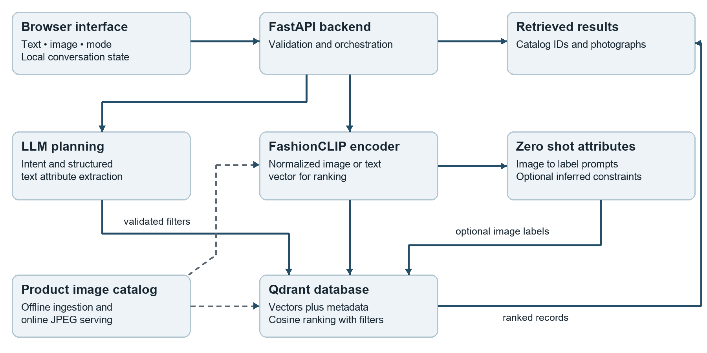
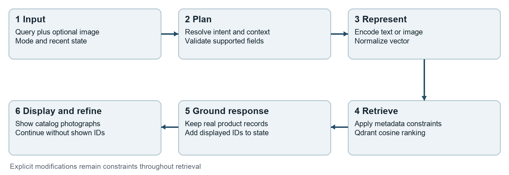
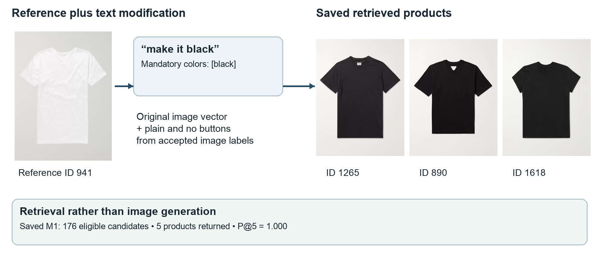
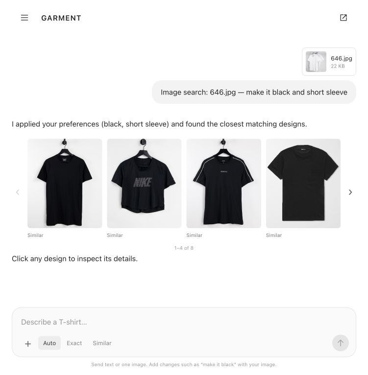
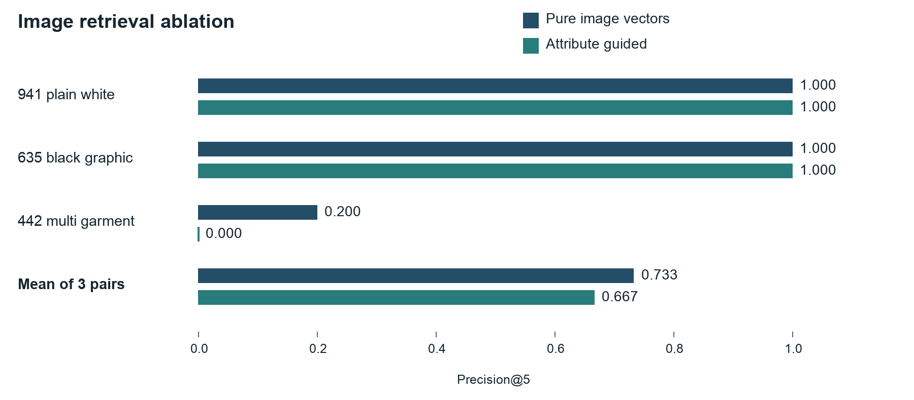

# GarmentChatbot

**COMP4431 Artificial Intelligence 2026/27 Group Project — The Hong Kong Polytechnic University**

- [A. Project Overview and Quick Start](#a-project-overview-and-quick-start)
- [B. Full Project Report](#b-full-project-report)
- [C. Supplementary Technical Documentation](#c-supplementary-technical-documentation)

## A. Project Overview and Quick Start

GarmentChatbot helps fashion design students and designers discover existing T-shirt references using text, images and conversational refinements. Supported text modifications change retrieval requirements; the application returns real catalog photographs rather than generating or editing images.

The full academic report appears directly below, including all five original figures, twelve tables, its normalization/cosine equation, evaluation findings, contributions and six references. Minor editorial corrections separate Sections 6.6 and 6.7, renumber validity as 6.8, repair punctuation and distinguish historical deployment evidence from current source configuration. The original report's writing and findings are retained; historical observations do not establish present service availability.

### Main features

- Text, image and image-plus-text search with Auto, Exact and Similar controls.
- Structured LLM planning, FashionCLIP vectors and Qdrant metadata filtering.
- Conversational refinement, compatible saved image references and non-repeating ID continuation.
- One to eight results, four-card carousel pages, product details and browser-local history.
- Browser speech recognition and synthesis where supported; live microphone acceptance remains outstanding.

### Team members

Names and student IDs are transcribed exactly from the report's team-member table.

| English name | Student ID |
|---|---|
| Ho Siu Wang | 24036797d |
| Kwok Ho Yam | 24058195d |
| Feng,Qihao | 24063665d |

### Installation and configuration

Commands below use a POSIX shell from the repository root. The recorded development baseline is Python 3.12 and Node 24; a fresh dependency install on every platform has not been validated.

```sh
git clone https://github.com/ivanho0908/GarmentChatbot.git
cd GarmentChatbot
python3.12 -m venv .venv
. .venv/bin/activate
python -m pip install -r backend/requirements.txt -r backend/requirements-api-test.txt
cp backend/.env.example backend/.env
```

Edit `backend/.env` privately:

- Set `POE_API`, `POE_URL` and `OPENAI_MODEL` for an approved Responses-compatible provider. Alternatively, remove/unset `POE_API` and `POE_URL` and configure `OPENAI_API_KEY` for SDK defaults. Empty strings are not equivalent to unset values.
- Supply `QDRANT_URL`, `QDRANT_COLLECTION` and, when required, `QDRANT_API` for an existing populated compatible collection. The saved study used 512-dimensional cosine vectors; confirm the embedding model, payload schema and image paths with the collection owner. A blank database alone cannot reproduce the search results.
- Set `CLIP_MODEL` to the exact model used for ingestion (saved-study identifier: `patrickjohncyh/fashion-clip`). Model weights must be available through approved downloads or a local cache. Optional `HF_TOKEN` is private and should be omitted when unnecessary.
- Set `CORS_ORIGINS=http://127.0.0.1:8000,http://localhost:8000` for the local commands below. A blank value overrides the default origin list and prevents browser access.

For local use, change only the public `API_BASE_URL` value in `frontend/config.js` to `http://127.0.0.1:8001`. Its committed value is a hosted URL. No frontend build or npm installation is required to serve the site. Never place credentials in frontend files.

Keep `backend/SKILL.md`, `backend/data/samples/sample_tshirt_schema.json` and the root catalog paths intact. Starting the API does not ingest or rebuild the collection. Offline ingestion writes Qdrant and is intentionally outside these run instructions. Private `.env` files, service keys and model caches are excluded from the submission.

### Running the frontend and backend

After setup, use two terminals:

```sh
# Terminal 1: repository root, virtual environment activated
cd backend
uvicorn api:app --reload --host 127.0.0.1 --port 8001
```

```sh
# Terminal 2: repository root
python3 -m http.server 8000 --bind 127.0.0.1 --directory frontend
```

Open [local frontend](http://127.0.0.1:8000/). The backend is at [local API](http://127.0.0.1:8001/), with interactive API documentation at `/docs`.

```sh
curl http://127.0.0.1:8001/api/health
```

Health reports liveness, not model, credential or Qdrant readiness. Real retrieval requires all external configuration above. Catalog photographs are served at `/images/tshirt/<id>.jpg`; missing images return 404. For the command-line agent, run `python chatbot.py` from `backend/` in the activated environment. Press **Ctrl+C** in each server terminal to stop it; run `deactivate` to leave the virtual environment.

### External requirements and known limitations

Supply approved model downloads/caches, private Responses-compatible LLM access and an existing compatible populated Qdrant collection. These are not included in the source archive. No collection rebuild or paid API call is part of submission preparation.

The catalog contains 1,993 JPEGs; IDs 357–363 are absent. Metadata can be noisy and Exact searches can underfill. Browser history is local to one origin, with no account or cross-device synchronization. Catalog provenance/licensing and historical credential rotation remain owner follow-up items. Current `frontend/config.js` points to Render; the report's Firebase/Cloud Run acceptance and timing evidence is historical. Neither proves current availability. See report Sections 4, 6 and 8 for the complete limitations.

## B. Full Project Report

**Garment Chatbot — A Multimodal Conversational System for T-Shirt Design Discovery**

COMP4431 Artificial Intelligence 2026/27 Group Project

### Report contents

- [Abstract](#report-abstract)
- [1 Introduction](#report-1-introduction)
  - [1.1 Background and motivation](#report-11-background-and-motivation)
  - [1.2 Objectives and target users](#report-12-objectives-and-target-users)
- [2 System overview and architecture](#report-2-system-overview-and-architecture)
- [3 Methodology](#report-3-methodology)
  - [3.1 Structured planning and intent recognition](#report-31-structured-planning-and-intent-recognition)
  - [3.2 Attribute extraction and a concrete text example](#report-32-attribute-extraction-and-a-concrete-text-example)
  - [3.3 FashionCLIP encoding and similarity](#report-33-fashionclip-encoding-and-similarity)
  - [3.4 Zero shot garment attribute inference](#report-34-zero-shot-garment-attribute-inference)
  - [3.5 Vector retrieval and metadata filtering](#report-35-vector-retrieval-and-metadata-filtering)
  - [3.6 Image plus text retrieval](#report-36-image-plus-text-retrieval)
  - [3.7 Conversational search management](#report-37-conversational-search-management)
  - [3.8 Continuation and duplicate prevention](#report-38-continuation-and-duplicate-prevention)
- [4 Implementation and user interaction](#report-4-implementation-and-user-interaction)
  - [4.1 Backend and frontend integration](#report-41-backend-and-frontend-integration)
  - [4.2 Deployment and operational boundaries](#report-42-deployment-and-operational-boundaries)
  - [4.3 Privacy and request controls](#report-43-privacy-and-request-controls)
  - [4.4 Browser voice features](#report-44-browser-voice-features)
- [5 Dataset and data processing](#report-5-dataset-and-data-processing)
  - [5.1 Catalog composition](#report-51-catalog-composition)
  - [5.2 Offline preparation and online reuse](#report-52-offline-preparation-and-online-reuse)
  - [5.3 Data quality and provenance](#report-53-data-quality-and-provenance)
- [6 Evaluation and results](#report-6-evaluation-and-results)
  - [6.1 Study design and relevance criteria](#report-61-study-design-and-relevance-criteria)
  - [6.2 Interpretation of primary results](#report-62-interpretation-of-primary-results)
  - [6.3 Paired image retrieval ablation](#report-63-paired-image-retrieval-ablation)
  - [6.4 Failure case analysis](#report-64-failure-case-analysis)
  - [6.5 Multi garment ambiguity](#report-65-multi-garment-ambiguity)
  - [6.6 Metadata compliance versus visual relevance](#report-66-metadata-compliance-versus-visual-relevance)
  - [6.7 Reproduction and software verification](#report-67-reproduction-and-software-verification)
  - [6.8 Validity and generalization](#report-68-validity-and-generalization)
- [7 Technical challenges and practical contributions](#report-7-technical-challenges-and-practical-contributions)
  - [7.1 Coordinating semantic and structured intent](#report-71-coordinating-semantic-and-structured-intent)
  - [7.2 Maintaining continuity across modalities](#report-72-maintaining-continuity-across-modalities)
  - [7.3 Integrating a deployable application](#report-73-integrating-a-deployable-application)
  - [7.4 Innovation and demonstration relevance](#report-74-innovation-and-demonstration-relevance)
- [8 Limitations and future work](#report-8-limitations-and-future-work)
- [9 Conclusion](#report-9-conclusion)
- [10 Team contributions](#report-10-team-contributions)
- [References](#report-references)

<a id="report-abstract"></a>

### Abstract

GarmentChatbot is a domain-specific conversational application that helps fashion design students and designers discover existing T-shirt references. Users can describe a garment, upload a reference image, or combine an image with a natural-language modification such as “make it black.” The application retrieves catalog products that satisfy the modified requirements; it does not generate or edit garment images. We integrate structured language-model planning, pretrained FashionCLIP representations, zero-shot garment attributes and Qdrant vector retrieval in a browser-based interface. Auto, Exact and Similar modes expose the trade-off between attribute compliance and visual or semantic proximity, while validated conversational state supports refinements and continuation without redisplaying previously returned product IDs.

The available catalog contains 1,993 images. A saved single-reviewer study of ten primary queries achieved mean Precision@5 of 0.660 and an 80% five-result fill rate. Image-plus-text cases averaged 0.867, but the small, non-equivalent query groups do not establish modality superiority. In a paired three-reference ablation, attribute-guided retrieval averaged 0.667 compared with 0.733 for pure image-vector retrieval. This negative result exposes the risk of filtering on imperfect image-derived labels, particularly for multi-garment references. The project's contribution is a controllable, deployed integration of pretrained AI components, supported by transparent evaluation and explicit operational limitations.

<a id="report-1-introduction"></a>

### 1 Introduction

<a id="report-11-background-and-motivation"></a>

#### 1.1 Background and motivation

Fashion design references often begin with an impression rather than a precise specification. A student assembling a mood board may recognize a silhouette, neckline or graphic treatment without knowing the terminology used in catalog descriptions. A designer may have a useful reference photograph but want a different colour or sleeve length. Keyword search requires users to translate these preferences into terms that match catalog metadata. Incomplete descriptions, synonyms and subjective aesthetic language can make that translation unreliable.

Image similarity reduces this vocabulary burden by allowing a photograph to express appearance directly. However, an image alone cannot communicate which features should change. A white reference may indicate a desired overall design while the user explicitly wants black products. Ranking only by the original image can preserve the unwanted colour. Conversely, treating every inferred property as mandatory may discard useful products because a model misidentified a pattern or interpreted background garments as part of the target.

We address this interaction problem by combining natural-language understanding, a shared image–text embedding space and structured retrieval constraints. The visual reference supplies similarity evidence; supported text modifications define requirements that take precedence over conflicting inferred attributes. The returned products remain existing catalog images. This distinction is central to the application: A request to change appearance changes the search conditions, not the pixels of a product photograph.

<a id="report-12-objectives-and-target-users"></a>

#### 1.2 Objectives and target users

The target users are fashion design students and designers exploring T-shirt references. Our objectives are to support everyday garment descriptions, image-based discovery and explicit modification of visual requirements; allow users to control retrieval strictness; and retain enough context for iterative exploration. The application supports design discovery rather than stock checking, purchasing, virtual try-on or garment generation.

<a id="report-2-system-overview-and-architecture"></a>

### 2 System overview and architecture

Figure 1 separates the interactive retrieval path from offline catalog preparation. The browser sends text or multipart image requests to FastAPI. The backend controls language planning, embedding, attribute extraction and Qdrant access. Product images are served separately from vector records; Qdrant stores vectors and payload metadata, not JPEG files [2](#report-reference-2).



**Figure 1. Overall system architecture. Solid arrows show online requests and results; dashed arrows show offline ingestion. The LLM proposes structured operations and the backend controls execution.**

| Layer | Implementation | Responsibility |
| --- | --- | --- |
| User interface | HTML CSS and JavaScript modules | Collect input and mode; display real products and local conversations. |
| Application service | FastAPI and Pydantic | Validate inputs and state; enforce policy; assemble responses and image URLs. |
| Language workflow | Responses-compatible LLM endpoint | Plan intent and context relation; extract supported attributes and modifications. |
| Representation | Pretrained FashionCLIP | Encode text and images; compare images with attribute-label prompts. |
| Retrieval and assets | Qdrant plus JPEG catalog | Filter payloads and rank vectors; supply original catalog photographs. |

**Table 1 Components and responsibilities**

The historical deployment described in this report used Firebase Hosting for the static frontend and Cloud Run for the backend. The current repository frontend configuration references https://garmentchatbot.onrender.com instead; neither configuration nor historical evidence establishes current deployment availability. The exact language model is privately configured; a compatible API client does not establish its deployed identity [2](#report-reference-2).

<a id="report-3-methodology"></a>

### 3 Methodology

<a id="report-31-structured-planning-and-intent-recognition"></a>

#### 3.1 Structured planning and intent recognition

For text requests, the language model commits to a bounded plan before retrieval. The plan_request schema contains intent, search_strategy, resolved_query, relation_to_context and result_count. Intent is restricted to search, informational, unrelated or clarification; strategy is exact, similar, both or none. Context relations distinguish a new topic, refinement and additional results, among other supported cases. The resolved query expresses a dependent turn as a standalone request [2](#report-reference-2).

Application code validates the plan, enforces the selected mode and invokes known functions. The model does not execute arbitrary code or directly operate Qdrant. This separation limits the effect of unsupported instructions and keeps product identities grounded in retrieval. Fashion information can receive a domain response, unrelated requests can be declined, and unclear requirements can trigger clarification. These controls constrain execution; they do not guarantee that every model interpretation is correct.

<a id="report-32-attribute-extraction-and-a-concrete-text-example"></a>

#### 3.2 Attribute extraction and a concrete text example

The text extractor uses a strict JSON schema. category, neckline and sleeve are nullable categorical fields; colors, patterns and style are arrays; buttons is Boolean or null. search_text preserves the original query. Normalization removes unsupported enum values and duplicates. Unspecified fields remain empty or null. Subjective language such as “Japanese” remains available to semantic retrieval rather than being converted into a guessed known style [2](#report-reference-2).

The saved T1 query, “Show me 5 black T-shirts,” provides a verified end-to-end example. The table below uses actual schema fields and saved output IDs. It distinguishes an illustrative valid plan from a recorded model trace: the study does not retain T1's complete planner JSON.

| Stage | Representation or recorded evidence |
| --- | --- |
| User request | Show me 5 black T-shirts. Mode auto. |
| Valid plan illustration | intent search; strategy exact; relation new_topic; result_count 5; resolved_query preserves the request. This plan is illustrative rather than a captured LLM response. |
| Supported extraction | colors [black]; category t-shirt is supported. The saved ranking does not prove every extracted field. Unspecified attributes must not be invented. |
| Encoding and filtering | Encode text with FashionCLIP; normalize the vector; apply supported black metadata constraints and rank eligible products by cosine similarity. |
| Recorded output | Product IDs 1335, 679, 1205, 1265 and 1354 in ranked order; 5 results; reviewer P@5 1.000. |

**Table 2 Schema consistent reconstruction of saved query T1**

This example avoids treating “without graphics” as a universally supported negative predicate. Text and image vocabularies also differ: the text schema uses graphic and logo, whereas image metadata uses graphic print and logo print. That mismatch is a concrete integration limitation requiring an audited mapping, not evidence that all compound failures have a known cause.

<a id="report-33-fashionclip-encoding-and-similarity"></a>

#### 3.3 FashionCLIP encoding and similarity

We use the pretrained patrickjohncyh/fashion-clip model through Transformers. FashionCLIP provides a common representation for fashion images and text [3](#report-reference-3), [4](#report-reference-4). Catalog images are encoded during offline ingestion; query text or a decoded reference image is encoded at search time. The configured collection and image-reference schema use 512-dimensional vectors. The same compatible representation must be used for ingestion and querying; matching vector dimensions alone would not make different models interchangeable [2](#report-reference-2).

The encoder converts its output to floating point and normalizes each vector by its L2 norm, with a small numerical floor to prevent division by zero. For nonzero vectors x and y, define normalized vectors u and v. Their dot product equals cosine similarity:

$$
u = \frac{x}{\lVert x \rVert_2}, \qquad v = \frac{y}{\lVert y \rVert_2}, \qquad \cos(x,y) = u^{\mathsf{T}}v
$$

Qdrant ranks eligible catalog vectors by the configured cosine metric. This supports text-to-image and image-to-image retrieval in one collection. A cosine value describes representational proximity; it is neither a relevance probability nor a confidence-calibrated statement about user satisfaction. Human judgments are therefore required for the evaluation in Section 6.

<a id="report-34-zero-shot-garment-attribute-inference"></a>

#### 3.4 Zero shot garment attribute inference

The attribute classifier reuses FashionCLIP. For each attribute, it embeds candidate-label prompts such as “a product photo of a black t-shirt,” then compares the normalized image vector with those prompt vectors. It records the highest-scoring label, runner-up, scores and their margin. Ingestion and online image analysis use the classifier vocabulary for colour, pattern, neckline, sleeve, style and visible buttons [2](#report-reference-2). No project-specific classifier training is required.

The retrieval policy accepts only supported labels with finite positive scores and sufficient separation. The current image policy uses a minimum margin of 0.015 for most attributes and 0.04 for style, where interpretation is more subjective. These thresholds are retrieval heuristics, not calibrated probabilities, and their optimality was not established by the saved study. Automatically inferred attributes are useful search evidence but remain susceptible to ambiguity, logos, backgrounds and multiple garments.

A MiniLM-based legacy text extractor is also present. Normal agent searches supply explicit filter dictionaries, so this extractor is not the product-vector encoder or a required attribute-matching step on every request [2](#report-reference-2).

<a id="report-35-vector-retrieval-and-metadata-filtering"></a>

#### 3.5 Vector retrieval and metadata filtering

Figure 2 connects planning and representation to the actual search operation. The backend constructs Qdrant field conditions from supported attributes and excludes displayed identifiers when continuing a search. In the inspected filter builder, different attribute conditions are combined with must, while alternative values within a field use MatchAny. Thus black and short sleeve require both fields, but black or navy blue within colors represents alternatives. Boolean button values use MatchValue [2](#report-reference-2), [5](#report-reference-5).



**Figure 2. End-to-end retrieval workflow. Representation supplies ranking and structured attributes restrict eligibility. Empty or underfilled results remain valid outcomes of strict retrieval.**

| Mode | Text input | Image or image plus text input |
| --- | --- | --- |
| Auto | Planner selects exact similar or both. It is not a fixed exact then fallback sequence. | Uses image similarity and optional reliable image attributes; may relax those inferred constraints while retaining explicit text requirements. |
| Exact | Requires supported filters and ranks matches with the text vector. No supported filter means no invented exact predicate. | Keeps mandatory text overrides and up to two reliable inherited image attributes. No silent relaxation of strict filters. |
| Similar | Uses text similarity without exact attribute requirements. | Ranks the original image vector without inferred hard filters. Supported explicit text changes remain mandatory. |

**Table 3 Search mode policies**

In Auto image retrieval, optional attributes are ordered by score margin and at most two are accepted. Each tentative filter must leave at least four times the requested result count as candidates. If an accepted combination subsequently underfills, the weakest optional filter is removed. Mandatory text constraints are never dropped by this relaxation loop. This policy attempts to balance specificity and availability, but candidate counts do not measure relevance and cannot prevent the failure shown in Section 6.4.

<a id="report-36-image-plus-text-retrieval"></a>

#### 3.6 Image plus text retrieval

The main user capability is illustrated in Figure 3 using the saved M1 study case. The reference is catalog image 941, a white plain T-shirt, and the instruction is “make it black.” The recorded parser output is intent modify with overrides {colors: [black]}. The original image embedding remains the ranking query; the system does not recolour the reference or learn a new combined embedding for this request [2](#report-reference-2).



**Figure 3. Verified multimodal search example from saved case M1. The original reference and first three returned catalog images are shown. All products are existing photographs; IDs and order come from results.csv. This is a visualization of a saved run, not a fresh query or a generated preview.**

The recorded effective filters were colors [black], patterns plain and buttons false, with 176 candidates. The black override superseded the inferred white colour, while the other accepted image attributes narrowed eligibility. The five returned IDs were 1265, 890, 1618, 1114 and 1288. All five were judged relevant under the recorded rubric, giving P@5 1.000. This single success demonstrates the intended interaction; it does not establish performance across arbitrary modifications.

Mixed-input parsing uses the image classifier's vocabulary and distinguishes modify, noop, unsupported, unrelated and clarification. It extracts explicitly stated changes without guessing unspecified requirements. Supported modifications override conflicting inherited attributes for the whole field. Unsupported material, price, brand or aesthetic requirements cannot be silently converted into verified product properties. Unrepresentable negations and conflicting singular constraints may require clarification. Partial unsupported requests are surfaced rather than treated as fully satisfied [2](#report-reference-2).

The same separation explains Similar mode: similarity controls ranking, while a requested black colour still constrains eligible products. Users would otherwise receive visually close white items despite their stated modification. Exact mode further preserves selected inherited image attributes, which can cause shortages if metadata is noisy. The interface should communicate these outcomes as retrieval constraints rather than image-editing instructions.

<a id="report-37-conversational-search-management"></a>

#### 3.7 Conversational search management

Conversational refinement requires typed state beyond the visible transcript. We retain a resolved query, effective strategy, validated attributes and identifiers of displayed products. A new topic replaces the active search; a dependent refinement resolves references to earlier requirements; “show more” continues the existing search. These distinctions prevent a continuation request from being interpreted as an unrelated new text query [2](#report-reference-2).

For images, the browser can retain a versioned ImageReference containing the model identifier, dimension, normalized embedding and original attribute analysis. Validation checks 512 finite values, a norm between 0.999 and 1.001, supported labels and model compatibility. Follow-up state records text overrides, effective image filters and the relevant mode. The original upload need not be retransmitted for each refinement, although the browser cannot reconstruct its original preview from an embedding.

The frontend stores local conversations and compatible reference state in localStorage. It can restore conversations after refresh in the same browser, but provides no server-side user account or cross-device synchronization. The original image file and audio are not retained as durable user assets. Local storage is client-owned and may be cleared or modified; structural validation makes it usable application input, not authenticated identity or trusted server memory.

<a id="report-38-continuation-and-duplicate-prevention"></a>

#### 3.8 Continuation and duplicate prevention

The result-count policy defaults to eight and permits one through eight results, capping larger requests. Non-positive quantities can trigger clarification. The evaluation deliberately requests five, independently of the interface default. The UI displays at most four product cards per carousel page, so carousel navigation only exposes products already returned; it is not a new retrieval operation [2](#report-reference-2).

True continuation sends the active search state back to the API. The backend excludes previously shown product and point identifiers and adds only final displayed results to the exclusion history. Typed lists are bounded at 4,096 identifiers. Compatible reference state and a reference revision prevent accidental reuse of a retry against a newer image. If eligible unseen products are exhausted, the application can return fewer results instead of filling the response with duplicates.

This mechanism prevents repeated identities within the retained search state. It does not establish visual deduplication: separate catalog IDs may represent near-identical garments. Likewise, a deliberate new search can legitimately redisplay an earlier product. Such boundaries matter when interpreting “non-repeating” conversational exploration and designing a live demonstration.

<a id="report-4-implementation-and-user-interaction"></a>

### 4 Implementation and user interaction

<a id="report-41-backend-and-frontend-integration"></a>

#### 4.1 Backend and frontend integration

POST /api/chat accepts text, mode and bounded context; POST /api/image-search accepts multipart image input with optional text; POST /api/image-search/continue supports saved image-reference turns. FastAPI validates request data and coordinates planning, encoding, retrieval and response assembly. Images are decoded in memory with format, byte-size and pixel limits. Catalog paths are resolved within an allowed image root to prevent traversal outside the intended asset directory [2](#report-reference-2).

The build-free JavaScript frontend provides local chat history, automatic titles, mode selection, image attachment, response playback and product inspection. Product labels and identifiers come from retrieved payloads. Generated wording is constrained to avoid inventing prices, stock or brands. Figure 4 shows an authentic earlier image-plus-text interaction with the visible modification and four returned cards.



**Figure 4. Actual chatbot interface from the saved image_text_browser.jpg validation screenshot. Reference 646 is accompanied by “make it black and short sleeve.” The screenshot predates later voice and mode refinements and is not a current deployment acceptance test. Source: project validation archive [2](#report-reference-2).**

The saved interface demonstrates image-plus-text interaction in GARMENT [6](#report-reference-6). A loaded frontend or restored conversation alone does not verify a new backend search.

<a id="report-42-deployment-and-operational-boundaries"></a>

#### 4.2 Deployment and operational boundaries

The historical documented production architecture served static files through Firebase Hosting and ran a CPU inference container on Google Cloud Run. The saved deployment configuration specifies asia-east2, one vCPU, 4 GiB memory, one worker, minimum instances zero, maximum instances one, container concurrency one and a 180-second timeout [2](#report-reference-2). These settings limit resource use but constrain concurrent responsiveness and allow model initialization delays after idle periods.

The historical production bundle included model caches and access to the existing catalog assets. Qdrant remains an external vector service and language planning uses a privately configured Responses-compatible endpoint. Runtime secrets are separate from public frontend configuration. The exact hosted model must be confirmed from the deployed configuration rather than inferred from a client library or a development default.

Reproducing the hosted application requires the correct frontend API configuration. The current frontend/config.js sets API_BASE_URL to https://garmentchatbot.onrender.com. This differs from the historical Firebase/Cloud Run evidence and does not establish current service availability; release settings should be confirmed before demonstration [2](#report-reference-2).

<a id="report-43-privacy-and-request-controls"></a>

#### 4.3 Privacy and request controls

The historical deployment described in this report included origin restrictions, request-size limits and process-level admission controls. The current repository verifies CORS, bounded request inputs and serialized agent access, but does not include the historical deployment's rate-limiting or spending controls. CORS constrains browser origins; it does not authenticate non-browser callers. Historical process-local rate limits could reset after restart. There is no verified end-user login requirement. The historical spending controls were operational safeguards, not proof of a guaranteed project-wide zero-cost or hard billing limit.

Uploaded files are processed for search rather than stored in a permanent user-image collection. Conversation content and reference vectors can remain in browser localStorage. The external LLM and Qdrant have separate retention policies: store=False in an SDK request alone does not establish provider-wide non-retention. Privacy terms, historical credential handling and redistribution permissions require team review before wider deployment.

<a id="report-44-browser-voice-features"></a>

#### 4.4 Browser voice features

Voice input uses browser speech recognition to produce text for the normal request path. Browser speech synthesis supports manual playback and optional response playback for voice-submitted turns. Availability depends on browser support, language settings, permissions and audio hardware. We do not operate a separate speech model. Source-level controls and recorded frontend checks do not establish a successful live microphone conversation; acceptance on the actual presentation device remains outstanding [2](#report-reference-2).

<a id="report-5-dataset-and-data-processing"></a>

### 5 Dataset and data processing

<a id="report-51-catalog-composition"></a>

#### 5.1 Catalog composition

The product metadata list contains 2,000 entries, while the available catalog contains 1,993 JPEG files totalling 378,919,404 bytes, approximately 361.4 MiB. Image IDs 357–363 are absent. Existing assets were retained without fabricating replacement images. The saved read-only Qdrant inspection reports 1,993 points with 512-dimensional cosine vectors, consistent with the available image count. Agreement in counts does not establish that every payload is correct [2](#report-reference-2).

| Item | Value | Interpretation |
| --- | --- | --- |
| Metadata records | 2000 | A record can exist without an available photograph. |
| Available JPEGs | 1993 | Search results must resolve to real image assets. |
| Missing image IDs | 357 through 363 | Seven gaps remain; no placeholders are evaluated as products. |
| Vector collection | 1993 points and 512 dimensions | Saved deployment inspection; no new collection mutation or census. |
| Attribute provenance | Automatically inferred during processing | Labels are retrieval metadata rather than human verified ground truth. |
| Rights and source | Unconfirmed for the catalog | Confirm provenance and redistribution permissions before release. |

**Table 4 Dataset inventory and implications**

<a id="report-52-offline-preparation-and-online-reuse"></a>

#### 5.2 Offline preparation and online reuse

Offline ingestion processes available product images, computes normalized FashionCLIP vectors and creates structured payloads, including product identity and relative image path. The zero-shot classifier scores supported garment labels. Multi-valued metadata may retain more than one description, which can increase coverage but also admit contradictory or overly broad labels. Starting the API does not rebuild the collection; ingestion is a separate operation [2](#report-reference-2).

Online retrieval reuses these stored vectors and labels. It encodes the current query and applies metadata predicates rather than reclassifying every catalog image on each request. This makes querying practical but means that erroneous stored labels can repeatedly affect strict search. The plain/logo co-labeling in Section 6.4 demonstrates why schema validity does not guarantee visual accuracy.

<a id="report-53-data-quality-and-provenance"></a>

#### 5.3 Data quality and provenance

Human relevance judgments are distinct from catalog metadata. A product carrying black or plain labels may still fail a reviewer's visual criterion. The saved annotations therefore assess photographs against a predeclared query rubric, not against the labels that retrieval itself used. No held-out training split is claimed because this project did not train the embedding model.

The catalog's upstream source and redistribution licence are not established. The public FashionCLIP model card identifies the pretrained artifact [4](#report-reference-4), but this does not confer rights to the project's images or verify the exact deployed weight licence and revision. A reproducible release should document permitted assets, model version and collection snapshot separately. These are future release tasks, not completed data-governance claims.

<a id="report-6-evaluation-and-results"></a>

### 6 Evaluation and results

<a id="report-61-study-design-and-relevance-criteria"></a>

#### 6.1 Study design and relevance criteria

We evaluated the saved retrieval snapshot using four text, three image and three image-plus-text queries, each requesting five products. Three additional pure-image runs form the ablation baseline. A single recorded human reviewer judged returned products against query-specific criteria; model scores and generated metadata were not used as relevance labels. Source-product IDs were excluded from the image comparisons, reducing trivial self-matches [2](#report-reference-2).

Precision@5 equals the number of relevant products among the first five positions divided by five, including unfilled positions in the denominator. A zero-result query therefore scores zero after explicit acknowledgment that the empty ranking is complete. T2 has this project-owner acknowledgment; no annotations for nonexistent products were created. The overall mean gives each primary query equal weight.

| ID | Query or reference and instruction | Returned | P@5 |
| --- | --- | --- | --- |
| T1 | Auto black T shirts | 5 | 1.000 |
| T2 | Auto white graphic short sleeve | 0 | 0.000 |
| T3 | Similar Japanese streetwear graphic | 5 | 0.800 |
| T4 | Exact red striped long sleeve | 2 | 0.200 |
| I1 | Image v2 plain white reference 941 | 5 | 1.000 |
| I2 | Image v2 black graphic reference 635 | 5 | 1.000 |
| I3 | Image v2 multi garment reference 442 | 5 | 0.000 |
| M1 | Reference 941 plus make it black | 5 | 1.000 |
| M2 | Reference 941 plus make it long sleeve | 5 | 1.000 |
| M3 | Reference 635 plus make it plain | 5 | 0.600 |
| Mean | Ten primary queries | 42 total | 0.660 |

**Table 5 Saved primary relevance results**

<a id="report-62-interpretation-of-primary-results"></a>

#### 6.2 Interpretation of primary results

Eight of ten queries returned five products, giving an 80% five-result fill rate. This measures result availability, not relevance accuracy. Text, image and image-plus-text means were 0.500, 0.667 and 0.867, respectively. Each group has only three or four different queries; their difficulty was not matched. The higher mixed-input mean is encouraging for the demonstrated modification tasks but cannot establish general modality superiority.

The 0.660 mean conceals large variation: five primary cases scored 1.000, while T2 and I3 scored zero. T4 returned only two products and one relevant result, yielding 0.200 under the fixed denominator. The study is therefore evidence of useful behavior on selected tasks alongside consequential failures, rather than a broad accuracy guarantee.

<a id="report-63-paired-image-retrieval-ablation"></a>

#### 6.3 Paired image retrieval ablation

The ablation compares pure image-vector retrieval v1 with attribute-guided retrieval v2 for the same three references. Each pair holds the cached reference vector, collection, source exclusion, requested count and relevance criterion constant. Qdrant cosine ranking is retained; the intervention changes candidate filtering. These historical arms should not be equated with every later unified image-mode combination [2](#report-reference-2).



**Figure 5. Saved paired image ablation. Mean P@5 is 0.733 for pure vectors and 0.667 for attribute guidance. Two references tie; the multi-garment case is worse with guidance. No uncertainty bars are implied by these three cases.**

| Reference | Pure v1 | Guided v2 | v2 minus v1 | Shared top five |
| --- | --- | --- | --- | --- |
| 941 plain white | 1.000 | 1.000 | 0.000 | 5 and same order |
| 635 black graphic | 1.000 | 1.000 | 0.000 | 5 and same order |
| 442 multiple garments | 0.200 | 0.000 | -0.200 | 0 |
| Mean | 0.733 | 0.667 | -0.067 | Three pairs |

**Table 6 Ablation results and ranking overlap**

Attribute guidance performed worse on average in this sample. The difference is entirely associated with I3; the first two pairs have identical ordered top-five results. Both methods returned five in all three cases, so the negative result concerns relevance, not filling the list. The evidence does not justify hiding the baseline, claiming a gain or asserting statistical significance.

Optional inferred constraints can improve controllability when correct, but can remove relevant candidates when wrong. A large eligible pool is insufficient protection: it may contain many products with an unsuitable inferred label. Crop selection, revised label criteria or alternative candidate policies would require new controlled comparisons before any improvement could be claimed.

<a id="report-64-failure-case-analysis"></a>

#### 6.4 Failure case analysis

The saved cases distinguish directly observed outcomes from plausible explanations. This matters because an empty ranking or poor retrieval does not reveal its complete cause. We use the saved diagnostics and product payloads to identify concrete mechanisms without treating them as independent ground truth [2](#report-reference-2).

| Case | Observation | Interpretation and future test |
| --- | --- | --- |
| T2 | No products for white graphic short sleeve | Sparse or mismatched metadata may explain the intersection. The trace does not isolate the cause or prove that visually relevant catalog items are absent. Audit the vocabulary and affected items. |
| T4 | Two products and one relevant item | Strict requirements underfill. A red metadata label does not ensure the garment meets the red dominant visual rubric. Show shortages and offer user controlled revision. |
| I3 | Guided P@5 zero versus pure 0.200 | Recorded multicolor and color block filters exclude the green plain baseline candidate. Whole image composition is a plausible cause of inference error. Test a foreground crop. |
| M3 | Three of five relevant after make it plain | Products 620 and 569 visibly retain branding and have both plain and logo print metadata. Audit nonexclusive labels and plain versus graphic criteria. |

**Table 7 Observed failures and proposed responses**

<a id="report-65-multi-garment-ambiguity"></a>

#### 6.5 Multi garment ambiguity

Reference 442 depicts a muted-green plain foreground T-shirt with other garments behind it. The relevance criterion targets the foreground garment, not the multipack composition. Pure retrieval places product 83, a visually similar plain green shirt, first. Guided retrieval returns 684, 720, 191, 260 and 439, with no overlap with the pure ranking. Its recorded multicolor and color block predicates exclude product 83's green/plain payload.

The predicates and changed candidate set are observed. The hypothesis that global image analysis conflated separate garments with one colour-blocked garment is plausible but not experimentally isolated. User-selected cropping could address this ambiguity, but it has not been implemented or evaluated as an improvement.

<a id="report-66-metadata-compliance-versus-visual-relevance"></a>

#### 6.6 Metadata compliance versus visual relevance

M3 illustrates a different problem. Both plain and logo print may be stored on the same product, allowing a visibly branded item to satisfy patterns [plain]. Filtering can be logically correct with respect to a payload while failing the user's visual requirement. The observed co-labeling establishes a mismatch; whether it arose from ambiguous labeling criteria or model error remains uncertain. Better metadata auditing should precede claims that tighter filtering will improve quality.

<a id="report-67-reproduction-and-software-verification"></a>

#### 6.7 Reproduction and software verification

Our recorded evaluation contains 57 ranked rows across 13 runs, 45 unique products and 42 rows in the ten primary queries. Recalculation of the recorded annotations reproduces the reported metrics; this is an arithmetic check rather than a new retrieval run or human review.

The recorded study predates full evaluation of later unified-mode features. Functional checks support those features, but the ten-query study does not validate relevance for every mode and continuation path.

| Evidence category | Recorded result | Boundary |
| --- | --- | --- |
| Offline regression logs | 164 backend 103 frontend and 8 script tests passed | Historical recorded run; many model calls mocked or Qdrant fixtures in memory. No new suite run is claimed here. |
| Hosted acceptance | Two rounds reported 12 of 12 checks each | First summary and second itemized records support workflows. The same 23 images must not be counted as 46 independent tests. |
| First model backed request | 31.375 seconds | Recorded activation request; not a repeated natural scale to zero cold start distribution. |
| Warm requests | First round 0.687 to 5.785 seconds with median 3.103; second 0.648 to 5.665 | Client observed request intervals including image checks; not isolated inference or a concurrent load benchmark. |
| Peak process RSS | 1198396 kB about 1.14 GiB | Saved process observation; not container wide memory consumption. |
| Browser voice | Controls and frontend behavior implemented | Actual microphone recognition acceptance remains unverified. |

**Table 8 Distinct functional and operational evidence**

<a id="report-68-validity-and-generalization"></a>

#### 6.8 Validity and generalization

The ten queries form a small, purposive sample judged by one reviewer. There is no inter-rater agreement estimate, broad user study, recall measurement, NDCG analysis or inferential significance claim. Similar-looking products may remain despite source exclusion. Subjective streetwear criteria can introduce judgment variation, and later changes to services or the catalog may change rankings.

Functional test counts, fill rate, latency and human P@5 answer different questions and must remain separate. The available evidence supports an integrated application with useful selected retrieval behavior. It does not establish production capacity, voice quality, long-term reliability or superior retrieval relative to conventional search, which was not evaluated as a controlled baseline.

<a id="report-7-technical-challenges-and-practical-contributions"></a>

### 7 Technical challenges and practical contributions

<a id="report-71-coordinating-semantic-and-structured-intent"></a>

#### 7.1 Coordinating semantic and structured intent

Natural descriptions exceed a finite catalog vocabulary. We preserve unsupported aesthetic concepts in text similarity while extracting only supported explicit attributes. Mode enforcement stays in application code, so a request cannot silently redefine Exact as unconstrained similarity. The contribution is understandable control over retrieval; the limitation is that vocabulary mismatch and extraction errors still affect results. The differing graphic/logo labels in text and image paths show why controlled schemas also need consistent semantics [2](#report-reference-2).

<a id="report-72-maintaining-continuity-across-modalities"></a>

#### 7.2 Maintaining continuity across modalities

An image follow-up needs the reference vector, override history and displayed identifiers as well as dialogue text. We implemented validated typed state, local persistence and separate continuation behavior. This allows a user to request a new colour and then explore more results while retaining the effective requirements. Bounded state and compatible model identifiers reduce accidental misuse, but browser storage is neither cross-device memory nor an authentication mechanism.

<a id="report-73-integrating-a-deployable-application"></a>

#### 7.3 Integrating a deployable application

Product paths, multipart uploads, JSON state and frontend cards must agree. Shared asset resolution and validation connect retrieved identities to real catalog files without duplicating the collection. The historical CPU deployment removed dependence on the developer's running computer, while its scale-to-zero and one-instance limits introduced latency and concurrency trade-offs.

<a id="report-74-innovation-and-demonstration-relevance"></a>

#### 7.4 Innovation and demonstration relevance

The practical innovation is the combined interaction: users communicate appearance through a reference image, specify supported changes in ordinary language, choose strictness and refine a continuing search. Controlled LLM planning connects this interface to deterministic retrieval rather than unrestricted agent execution. The value lies in making existing AI components work together for design-reference discovery; no novel model-training result is claimed.

| Criterion in the course brief | Concrete evidence to demonstrate |
| --- | --- |
| Basic domain communication worth 3 of 10 demo marks | Submit an English garment query and explain relevance of returned catalog images. |
| Additional features worth 7 of 10 demo marks | Show image input plus make it black; compare mode behavior; refine and request more products. |
| Technical contribution and complexity | Explain plan validation embeddings filters and reference state with Figures 1 to 3; show the negative ablation honestly. |
| Interface and usability | Demonstrate mode selection attachment product inspection and history. Verify voice hardware before including it. |
| Creativity and presentation quality | Explain the design student use case and changed visual requirements; include a shortage or ambiguity case and its limitations. |

**Table 9 Demonstration alignment with course criteria**

<a id="report-8-limitations-and-future-work"></a>

### 8 Limitations and future work

The highest priority is better evidence and metadata quality rather than unsupported claims of new model capability. Table 10 pairs each major limitation with its impact and a realistic next step. All proposed work remains prospective.

| Limitation | Practical impact | Proposed improvement |
| --- | --- | --- |
| Ten queries and one reviewer | Means are unstable across query choices and subjective criteria. | Expand a stratified query set; obtain independent ratings and agreement; report ranking metrics and uncertainty appropriately. |
| Automatically inferred metadata | Visually relevant items can be excluded or mislabeled products admitted. | Audit a human reviewed sample; reconcile vocabularies and plain/logo criteria before testing revised filters. |
| Multi garment reference ambiguity | The whole composition can dominate attributes and embedding. | Offer a target region or crop; compare full image and crop on a fixed reference set. |
| Strict filtering | Valid requirements may return few or no images. | Explain supported constraints and shortages; let users explicitly broaden the search rather than silently relaxing requirements. |
| No project fine tuning | Representations may miss local design vocabulary and subtle preferences. | First benchmark failure categories; consider a licensed adaptation dataset only if justified by evidence and resources. |
| Cold start latency | First interaction after idle can disrupt a demonstration. | Measure repeated idle starts and readiness separately; evaluate budgeted minimum instances if needed. |
| Limited concurrency | One instance and concurrency one may queue users. | Run controlled concurrent load tests before adjusting limits and admission policy. |
| Catalog source and licence uncertainty | Redistribution and reproducibility remain unresolved. | Document provenance and permissions; verify model artifact terms and package only authorized assets. |
| Voice acceptance incomplete | Browser controls may fail on the presentation device. | Test permissions recognition language and synthesis on the actual supported browser and hardware. |
| Client local memory and external services | History can disappear; provider retention and access differ. | Document storage and privacy behavior; review provider terms and any future authenticated persistence design. |
| Configuration drift | Development URLs can prevent reproduction of production behavior. | Confirm the release API configuration and public README against the deployed build before packaging. |

**Table 10 Limitations and proposed improvements**

The catalog also has seven missing images and may contain near-duplicate designs. Expanding coverage should preserve stable product IDs and explicit asset checks. Neither a larger catalog nor a more complex model guarantees better relevance; improvements require a controlled rerun with unchanged rubrics and separately reported new results.

<a id="report-9-conclusion"></a>

### 9 Conclusion

GarmentChatbot integrates conversational language understanding, FashionCLIP embeddings, zero-shot attributes and filtered Qdrant retrieval into a T-shirt reference-search application. Its principal capability is to retrieve existing products resembling an uploaded reference while respecting supported natural-language modifications. Explicit modes and validated state make the search process controllable and support iterative exploration without repeated identities within the retained search.

The saved study shows both useful behavior and clear failure cases. Mean P@5 is 0.660 across ten primary queries, with an 80% five-result fill rate. Attribute-guided image retrieval scores 0.667 compared with 0.733 for pure image vectors on three references. This negative ablation result limits claims about automatic attribute guidance and motivates improved foreground selection and metadata auditing. Further evaluation, confirmed asset provenance and live voice and operational checks are needed before broader reliability claims.

Our contribution is the end-to-end engineering of a functional multimodal conversational workflow, together with transparent evaluation of its current behavior. The next development cycle should prioritize reproducible evidence and correction of demonstrated limitations.

<a id="report-10-team-contributions"></a>

### 10 Team contributions

The course requires a group of two to four students with equally shared workload [1](#report-reference-1). Complete and confirm the member record and allocations below before submission. No names, IDs, percentages or individual assignments are inferred from repository authorship.

| Member | English name | Student ID |
| --- | --- | --- |
| 1 | Ho Siu Wang | 24036797d |
| 2 | Kwok Ho Yam | 24058195d |
| 3 | Feng,Qihao | 24063665d |

**Table 11 Team member record requiring confirmation**

| Work package | Work to attribute | Member and evidence |
| --- | --- | --- |
| Dataset and AI retrieval | Preparation ingestion embeddings labels and search policy | Ho Siu Wang |
| Backend and integration | Planning APIs validation state and asset serving | Ho Siu Wang |
| Frontend and interaction | Conversation UI modes image input history and voice controls | Feng,Qihao |
| Evaluation and deployment | Rubrics annotations metric computation tests and hosting | Feng,Qihao |
| Report and presentation | Writing figures integration review slides and live demo | Kwok Ho Yam |

**Table 12 Work package allocation requiring confirmation**

<a id="report-references"></a>

### References

<a id="report-reference-1"></a>

[1] COMP4431 Artificial Intelligence, “Group project specification: Domain-specific chatbot development,” course brief, 2026/27, pp. 1–4.

<a id="report-reference-2"></a>

[2] Project team, “GarmentChatbot,” GitHub repository, branch main. [Online]. Available: [https://github.com/ivanho0908/GarmentChatbot](https://github.com/ivanho0908/GarmentChatbot). Repository reference updated: Nov. 17, 2026; the original report cited the earlier x-Robe feature branch accessed on Nov. 13, 2026.

<a id="report-reference-3"></a>

[3] P. J. Chia et al., “Contrastive language and vision learning of general fashion concepts,” Scientific Reports, vol. 12, no. 1, Art. no. 18958, Nov. 2022. doi: [https://doi.org/10.1038/s41598-022-23052-9](https://doi.org/10.1038/s41598-022-23052-9). Accessed: Nov. 13, 2026.

<a id="report-reference-4"></a>

[4] patrickjohncyh, “Fashion CLIP,” model card, Hugging Face. [Online]. Available: [https://huggingface.co/patrickjohncyh/fashion-clip](https://huggingface.co/patrickjohncyh/fashion-clip). Accessed: Nov. 13, 2026.

<a id="report-reference-5"></a>

[5] Qdrant, “Filtering,” official documentation. [Online]. Available: [https://qdrant.tech/documentation/search/filtering/](https://qdrant.tech/documentation/search/filtering/). Accessed: Nov. 13, 2026.

<a id="report-reference-6"></a>

[6] GarmentChatbot project team, “GARMENT,” web application. [Online]. Available: [https://garmentchatbot.web.app/](https://garmentchatbot.web.app/). Accessed: Nov. 13, 2026.

## C. Supplementary Technical Documentation

### API and architecture reference

```text
Browser: text / image / mode / bounded conversation state
    |
    | JSON or multipart HTTP
    v
FastAPI: validation, orchestration and response assembly
    +--> Responses-compatible LLM: plan, resolve context, extract attributes
    +--> FashionCLIP: normalized text or image query vector
    |       +--> Zero-shot label prompts: optional image attributes
    +--> Qdrant: metadata eligibility + cosine-vector ranking
    |       --> ranked product payloads and identifiers
    +--> /images: original JPEGs from data/images/
    |
    v
Browser: product cards, details, refinement and continuation

Offline preparation (separate, not run on API startup):
Catalog images --> FashionCLIP + attribute classifier --> Qdrant vectors/payloads
```

Different attribute fields combine using Qdrant `must`; alternatives within one field use `MatchAny`, and Boolean button requirements use `MatchValue`. Qdrant stores vectors and metadata, while JPEG files remain in the repository catalog. Image paths resolve within the permitted asset root.

Endpoints include `POST /api/chat`, `POST /api/image-search`, `POST /api/image-search/continue`, `GET /api/health` and static `/images/...`. See [API documentation](backend/API.md) and [architecture notes](docs/ARCHITECTURE.md). Uploaded images are decoded in memory with format, byte and pixel validation.

### Dependencies and deployment configuration

| Component | Role |
|---|---|
| HTML, CSS, JavaScript ES modules | Build-free browser application; Node runs frontend tests. |
| FastAPI, Pydantic, Uvicorn, python-multipart | HTTP API, typed validation, ASGI serving and multipart uploads. |
| PyTorch, Transformers, safetensors | Load pretrained FashionCLIP and compute embeddings. |
| `patrickjohncyh/fashion-clip` | Saved-study image/text representation; compatible 512-dimensional collection required. |
| NumPy, Pillow | Vector operations and image decoding. |
| Qdrant client and external Qdrant service | Filtered cosine search over existing catalog vectors/payloads. |
| OpenAI Python SDK and Responses-compatible endpoint | Structured planning, extraction and conversational wording; actual model selected privately by configuration. |
| sentence-transformers / `all-MiniLM-L6-v2` | Legacy optional text-to-label extraction when explicit filters are not supplied; not the product-vector encoder. |
| python-dotenv, pandas, tqdm | Configuration and supporting data/ingestion utilities. |

See [backend requirements](backend/requirements.txt), [test requirements](backend/requirements-api-test.txt) and [recorded development versions](docs/TESTED_VERSIONS.md). Requirements are not a cross-platform lock. The root Firebase package/configuration supports hosting; it is unnecessary for the local static frontend.

The report records Firebase Hosting with a CPU Cloud Run backend. This checkout's public [frontend configuration](frontend/config.js) instead targets `https://garmentchatbot.onrender.com`; neither the report nor that constant proves the current deployed backend. Cloud Run settings and historical timing figures in the report must not be assumed to describe this Render target. Current hosted searches were not invoked during submission preparation.

### Repository structure

```text
GarmentChatbot/
├── README.md
├── frontend/                    Website, config.js and Node unit tests
├── backend/
│   ├── api.py                   FastAPI HTTP entry point
│   ├── chatbot.py               Language agent and command-line interface
│   ├── SKILL.md                 Application runtime prompt, required by agent
│   ├── .env.example             Nonsecret configuration template
│   ├── requirements*.txt        Runtime and API-test dependencies
│   ├── src/                     Embeddings, search, schemas, state and ingestion
│   ├── data/                    Product metadata and required attribute schema
│   ├── tests/                   Offline regression tests
│   └── other_tools/             Data preparation utilities
├── data/
│   ├── images/tshirt/           Original 1,993 JPEGs, paths preserved
│   ├── products.json            Root catalog metadata
│   ├── products.csv
│   └── samples/
├── evaluation/                  Saved rankings, labels, metrics and scripts
├── docs/
│   ├── report_assets/           Five original figures extracted from the report
│   └── ...                      Architecture, asset manifests and prior validation
├── models/                      Additional model helper
├── firebase.json               Static hosting configuration
└── package.json                Root Firebase dependency
```

There are 2,000 metadata entries and 1,993 available JPEGs (378,919,404 bytes, approximately 361.4 MiB); image IDs 357–363 are absent. The asset manifest documents the existing catalog. No replacement images, model caches or Qdrant snapshot are included. Older handover documents describe earlier integration stages; use the current source and these run instructions for this submission.

### Saved evaluation and offline verification

The study and numerical findings are preserved in full in report Section 6. See [evaluation report](evaluation/EVALUATION_REPORT.md), [saved summary](evaluation/summary.csv) and [reproduction notes](evaluation/README.md). To recompute the saved annotations without provider calls:

```sh
python evaluation/calculate_metrics.py
```

The script writes metric CSVs; it does not rerun retrieval or generate relevance labels. Original study inputs must remain unchanged.

For offline functional checks from the repository root:

```sh
node --test frontend/*.test.js
cd backend
CLIP_MODEL=patrickjohncyh/fashion-clip PYTHONPATH=.:tests python -B -m unittest test_chatbot_results test_api test_image_api test_image_text test_hybrid_image_search test_image_search test_extraction_robustness test_pagination test_image_context test_result_count test_unified_modes test_repository_layout
```

Submission verification on 17 November 2026 reran **103 frontend and 160 backend tests successfully**, using bundled Node and the existing local Python 3.12 development environment. Catalog hashes and real HTTP image serving passed; metric recomputation matched the saved CSV values. No fresh dependency installation, live retrieval, paid API call or microphone test was performed.

The report's historical 164-backend/103-frontend/8-script record belongs to later deployment evidence; not all those deployment artifacts exist in this checkout. The repository's reproducible suite contains 160 backend and 103 frontend tests. These counts and saved retrieval relevance answer different questions. No new live retrieval, paid API call or microphone acceptance is claimed.

### Supporting records

[Dataset notes](docs/DATASET_ASSETS.md) · [Integration evidence](docs/INTEGRATION_REPORT.md) · [Historical hosting handover](docs/HANDOVER.md) · [Recorded development versions](docs/TESTED_VERSIONS.md)

The report's original team confirmation wording and contribution assignments are preserved without inference. Source and hosted configuration can differ from the historical deployment, as explicitly noted in the report. The Word page-number contents have been replaced with the clickable contents above.
